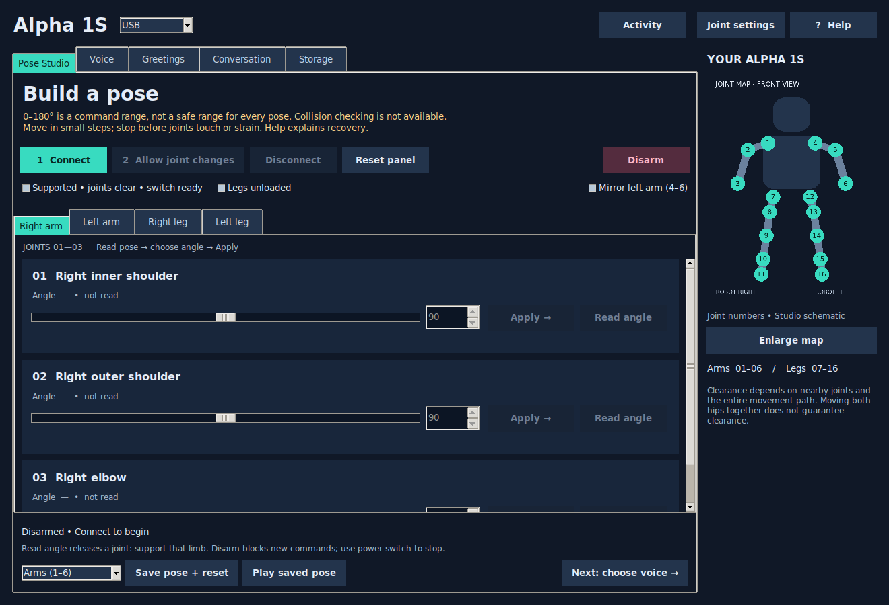
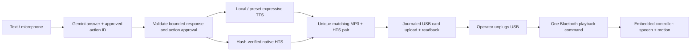

# Alpha 1S Studio

### Embodied AI · Embedded-systems integration · Human–robot interaction

Turn a UBTECH Alpha 1S into an interactive robot that answers questions through its own speaker and performs approved gestures alongside its speech.

Alpha 1S Studio connects a Python desktop application, Gemini, speech synthesis, and the robot's existing embedded controller. It bridges model decisions and physical behavior through validated action selection, explicit operator controls, USB file transfer, and Bluetooth protocol adapters.

**Linux desktop application · MIT licensed · Uses the original robot controller**



*Pose Studio: joint controls, pose capture and playback in the desktop application.*

## See the system in action

1. Build a pose using the 16-joint editor.
2. Choose a voice and expressive delivery; preview or test a message.
3. Combine a pose and message into a named greeting.
4. Ask a question by typing or microphone. Gemini creates a concise answer and selects an approved gesture.
5. Upload new speech over USB, unplug when prompted, and hear the robot speak while it performs the library action.

Simultaneous speech and Celebrate motion were observed on the development robot, including a 4.04-second recording that continued after the 2.2-second gesture. The integrated Studio workflow was also confirmed by the operator. Rehearse each action before use; the embedded controller manages playback timing.

## Download and launch

Download the source ZIP from [Releases](https://github.com/MohdFaisal2165/alpha1s-studio/releases), extract it into a folder you own, and follow [Setup](docs/SETUP.md). Or clone:

```bash
git clone https://github.com/MohdFaisal2165/alpha1s-studio.git
cd alpha1s-studio
/usr/bin/python3 scripts/check_environment.py
./launch-control-panel.sh
```

Install the Linux prerequisites first. This release is a **portable source package** launched with the supplied script. Keep the extracted folder intact and writable. Use Connect and the operator controls to begin a robot session.

**Start here:** [Installation and first robot setup](docs/SETUP.md) · [Using Studio](docs/DEMO.md) · [Troubleshooting](docs/TROUBLESHOOTING.md)

## Capabilities and compatibility

| Area | Implemented behavior |
| --- | --- |
| Pose Studio | 16-joint control, angle readback, saved poses, captured default posture |
| Voice | Local speech synthesis or Gemini preset voices with expressive delivery |
| Greetings | Named profiles combining a saved pose and generated recording |
| Conversation | Typed or computer-microphone questions, concise new answers, approved gesture selection |
| Simultaneous playback | Matching MP3/HTS pair, one Bluetooth playback command, full recording completion observed with Celebrate |
| Storage | Verified uploads, recording management, protected greeting references |
| Credentials | Optional OS key vault for saved API credentials |
| Current information | Optional web search through the model API; availability and quota depend on the account |

Tested configuration: **Linux desktop with X11/XWayland, hardware `Alpha1_V2.0`, firmware `2016070416`, original 124 MiB FAT32 card**.

Fresh recordings follow **USB upload → unplug → Bluetooth playback**. Replaying an exact verified speech-and-action pair is wireless.

## Engineering architecture



Gemini selects approved action identifiers. Studio resolves them to local assets, verifies their content and executes them through its robot transport adapters.

### Embedded-systems work demonstrated

- USB HID and Bluetooth RFCOMM integration with packet framing, checksums, response validation and firmware identity checks.
- Persistent transport sessions, exclusive access, bounded waits and explicit handling of uncertain delivery.
- Actuator command orchestration, measured versus commanded state, operator arming and fault recovery.
- FAT32 inspection, source-verified backups, bounded sector updates, write journals and readback checks.
- Integration of host-side AI with an existing embedded motion/audio controller.
- Mocked transport and filesystem regression tests, reproducible source releases and CI.

This project demonstrates **embedded software integration and protocol engineering** through transport adapters, actuator orchestration, verified storage operations and AI-driven action selection. See [Engineering architecture](docs/ARCHITECTURE.md) for the implementation.

## Responsible operation

Check body clearance across the entire movement path when choosing angles within the 0–180° command range. Angle reads may briefly release joints. Support the robot, unload legs when required, and keep the power switch reachable. Software Stop blocks subsequent commands; use the physical power switch when immediate intervention is needed. Read [Safety](docs/SAFETY.md).

## Project layout

```text
alpha_demo/       desktop UI, AI orchestration and embedded protocol adapters
assets/           original joint-ID schematic
docs/             setup, user guide, architecture and troubleshooting
scripts/          environment checks, first-run card setup and release export
tests/            offline regression tests
.github/          CI and contribution templates
```

The download includes ready-made `data/`, `reports/`, `work/` and `backups/` folders. Setup and Studio populate them automatically, with generated contents kept local. Import native actions from your own robot card during setup.

## Simulation development

The next phase explores a calibrated Alpha 1S digital twin in Docker with NVIDIA Isaac Sim. See the [development plan](docs/SIMULATION.md) for model import, joint mapping, pose preview and supervised execution milestones.

## Development

```bash
xvfb-run -a /usr/bin/python3 -m unittest discover -s tests -v
/usr/bin/python3 scripts/export_release.py
```

Tests use offline transport and filesystem fixtures. See [Contributing](CONTRIBUTING.md), [Release process](docs/RELEASE.md), [Changelog](CHANGELOG.md) and [Security](SECURITY.md).

An independent community project integrating the UBTECH Alpha 1S with the Gemini API. [MIT license](LICENSE) · [Third-party notices](THIRD_PARTY_NOTICES.md).
